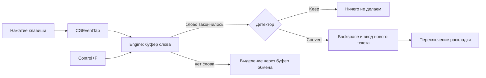

# lang-changer

Лёгкая утилита для macOS на Rust, которая исправляет текст, набранный не в той раскладке (RU ↔ EN). Работает как PuntoSwitcher: набрали `ghbdtn`, нажали пробел, получили `привет`.

```text
ghbdtn␣   →   привет␣        (и раскладка переключилась на русскую)
руддщ␣    →   hello␣         (и раскладка переключилась на английскую)
```

> **Статус:** ранняя версия. Логика покрыта тестами (68 штук), но работа с клавиатурой, буфером обмена и меню проверена только компиляцией. Перед использованием пройдите [чек-лист](#проверка-вручную).

## Что умеет

| Возможность | Как работает |
|---|---|
| **Автозамена** | Слово исправляется само, когда вы ставите пробел или знак препинания (`! ? ) " . , ;`) |
| **Хоткей `Control+F`** | Конвертирует выделенный текст, а если ничего не выделено, то последнее слово |
| **Отмена** | `Control+F` или `Backspace` сразу после автозамены возвращает как было и запоминает слово |
| **Меню `Ru⇄En`** | Переключатель автозамены и выход |
| **Автозапуск** | Одна команда ставит утилиту в LaunchAgent |
| **Лёгкость** | Бинарник около 2 МБ, словари вшиты внутрь, внешних файлов не нужно |

Регистр сохраняется (`Ghbdtn` → `Привет`), знаки препинания на русских буквенных клавишах учитываются (`j,hfpjv` → `образом`), а после замены раскладка переключается на ту, в которую перевели.

## Как это выглядит внутри



**Как детектор решает, что слово не в той раскладке:**

1. Слово, которое уже есть в словаре своей раскладки (`hello`, `привет`), не трогаем.
2. Если слово после конвертации есть в словаре другого языка (`ghbdtn` → `привет`), исправляем.
3. Для незнакомых английских слов от 5 букв сравниваем правдоподобность по буквенным триграммам, и исправляем, только если английский вариант заметно хуже русского.

**Что никогда не исправляется автоматически:**

- слова короче 3 букв (кроме частых слов вроде `yt` → `не`);
- всё, где есть цифры или кодовая пунктуация: `getUserName`, `foo_bar`, `v2.1`, `https://x.y`, `std::vec`, `10 kb`;
- CamelCase, e-mail, пути, технические слова (`http`, `xml`, `cfg`, `gcc`…);
- слова, для которых вы уже отменяли автозамену;
- слова перед `Enter` и `Tab`: для них используйте хоткей.

## Установка

Нужны macOS и [Rust](https://rustup.rs).

```sh
git clone git@github.com:yumeinaruu/lang-changer.git
cd lang-changer
cargo build --release
./target/release/lang-changer
```

В строке меню появится `Ru⇄En`.

### Разрешения

macOS попросит два разрешения. Выдайте их в **System Settings → Privacy & Security** тому приложению, из которого запускаете утилиту (Terminal, iTerm…):

- **Accessibility**
- **Input Monitoring**

После этого перезапустите утилиту. В полях ввода паролей macOS сама отключает перехват клавиш, там утилита молчит.

### Автозапуск при входе

```sh
./target/release/lang-changer install-agent     # создаёт ~/Library/LaunchAgents/com.lang-changer.plist
./target/release/lang-changer uninstall-agent   # убирает
```

Агент запускается без терминала, поэтому разрешения нужно выдать самому бинарнику `target/release/lang-changer` (кнопка «+» в обоих разделах). Утилита перезапускается только после аварийного завершения, поэтому Quit из меню работает.

## Настройка

Файл `~/.config/lang-changer/config.toml` (все ключи необязательные):

```toml
hotkey = "ctrl+f"   # модификаторы ctrl/alt/cmd/shift и одна клавиша: буква, цифра или "space"
threshold = 1.0     # чем больше, тем осторожнее автозамена
enabled = true      # включена ли автозамена при запуске
```

Слова, для которых вы отменили автозамену, лежат в `~/.config/lang-changer/leave_alone.txt` по одному в строке. Чтобы «простить» слово, удалите его строку.

> **Важно:** пока утилита запущена, `Control+F` перехватывается и больше не двигает курсор вправо в текстовых полях. Если это мешает, поменяйте `hotkey` в конфиге.

## Проверка вручную

Пройдите в Terminal, Safari, Notes и VS Code:

- [ ] `ghbdtn ` → `привет `, раскладка стала русской
- [ ] `руддщ ` на английской раскладке → `hello `
- [ ] `hello `, `да `, `getUserName `, `foo_bar `, `v2.1 ` остаются как есть
- [ ] `ghbdtn! ` → `привет! `, а `ghbdtn, ` → `привет, `
- [ ] `Backspace` сразу после автозамены возвращает `ghbdtn `, повторно слово не исправляется
- [ ] Выделить `ghbdtn`, нажать `Control+F` → `привет`; прежнее содержимое буфера обмена на месте
- [ ] Без выделения: `nginx` и `Control+F` конвертируют слово
- [ ] Выключить автозамену в меню: сама не работает, хоткей работает
- [ ] Поле пароля: ничего не происходит, падений нет

## Известные ограничения

- Слова, которые начинаются с `х ъ ж э б ю` и набраны на английской раскладке (`это`, `быть`, `хорошо`), автоматически не исправляются, потому что эти клавиши в начале слова считаются знаками препинания. Хоткей их конвертирует.
- При очень быстром наборе клавиша, нажатая сразу после автозамены (в пределах около 8 мс), может вклиниться между стиранием и вводом нового текста.
- Поддерживается только стандартная русская раскладка ЙЦУКЕН поверх US/ABC.
- Переключатель автозамены в меню не запоминается между запусками (для этого есть `enabled` в конфиге).

## Разработка

```sh
cargo test                            # 68 тестов
cargo clippy --all-targets -- -D warnings
```

| Модуль | Назначение |
|---|---|
| `layout_map` | Таблица раскладок ЙЦУКЕН ↔ QWERTY |
| `detector` | Решает «исправлять или нет» по словарям и триграммам |
| `engine` | Состояние набора: буфер слова, автозамена, отмена, хоткей |
| `keys` | Превращает нажатие клавиши в событие для `engine` |
| `tap` | `CGEventTap`, разрешения macOS, связка всех частей |
| `inject`, `injector` | Ввод текста синтетическими событиями, очередь замен |
| `input_source` | Переключение раскладки через Text Input Sources |
| `clipboard` | Выделенный текст через буфер обмена с полным восстановлением |
| `config`, `cli`, `launch_agent`, `menubar` | Конфиг, команды, автозапуск, иконка в меню |

Спека и план реализации лежат в [`docs/superpowers`](docs/superpowers).

## Словари

Детектор использует списки из 20 000 самых частых слов каждого языка. Они взяты из [hermitdave/FrequencyWords](https://github.com/hermitdave/FrequencyWords) (OpenSubtitles 2018), лицензия CC-BY-SA 4.0. Подробности в [`data/README.md`](data/README.md).
